# Feature map

Generated by `python tools/feature_map.py` from [`feature_map.toml`](feature_map.toml); edit that
file, never this one. CI refuses a command, MCP tool, console script or module that no feature
claims, a path that does not exist, and a page that differs from its source.

To find where something lives: look its entry point up in the index below, or run
`python tools/feature_map.py --which <path>` for the features a file belongs to. A `*` in a
path matches across directories. For which module imports which, see
[`ARCHITECTURE_MAP_GENERATED.md`](ARCHITECTURE_MAP_GENERATED.md).

```mermaid
flowchart LR
  s_cli["recall CLI"]
  s_mcp["MCP server"]
  s_scripts["other console scripts"]
  subgraph a_1["Install and connect"]
    f_install["Install, setup wizard and uninstall"]
    f_doctor["Doctor and capability diagnostics"]
    f_cli["The recall command line"]
    f_hooks["Claude Code and Codex hooks"]
  end
  subgraph a_2["Write path"]
    f_indexing["Indexing and ingest"]
    f_embeddings["Embedders, profiles and the embedding cache"]
    f_multimodal["Multimodal memory"]
    f_generations["Generations, promotion and routing"]
    f_manifests["Corpus manifests"]
  end
  subgraph a_3["Read path"]
    f_search["Search, evidence and the trust gate"]
    f_calibration["Calibration and drift"]
    f_atomic_rescue["Atomic rescue"]
    f_graph["Semantic graph and related evidence"]
    f_reasoning["Reasoning, proposals and query construction"]
  end
  subgraph a_4["Memory truth"]
    f_supersession["Supersession and write-time lint"]
    f_facts["Fact ledger and provenance controller"]
    f_claim_extraction["Claim extraction and rewrite"]
    f_forget["Forget and withdraw"]
    f_audit_records["Audit records"]
    f_repair_checks["Repair check selection"]
    f_agent_reports["Agent stale and use reports"]
  end
  subgraph a_5["Surfaces"]
    f_mcp_server["MCP server"]
    f_auth["Authentication, tenancy and source policy"]
    f_assistant["Assistant memory surface"]
    f_lite["Lite store (one SQLite file)"]
    f_dashboard["Review dashboard"]
    f_desktop["Windows desktop app"]
    f_integrations["Agent SDK and framework integrations"]
    f_hosted["Hosted memory API (AML)"]
  end
  subgraph a_6["Operations"]
    f_storage["PostgreSQL store, schema and receipts"]
    f_operations["Production operations"]
    f_observability["Observability and the decision ledger"]
    f_foundation["Shared foundation"]
  end
  subgraph a_7["Research"]
    f_evaluation["Evaluation harness and consistency audit"]
  end
  s_cli --> f_install
  s_scripts --> f_install
  s_cli --> f_doctor
  s_scripts --> f_hooks
  s_cli --> f_indexing
  s_mcp --> f_indexing
  s_cli --> f_generations
  s_scripts --> f_generations
  s_cli --> f_manifests
  s_cli --> f_search
  s_mcp --> f_search
  s_cli --> f_calibration
  s_mcp --> f_calibration
  s_cli --> f_graph
  s_mcp --> f_graph
  s_cli --> f_reasoning
  s_mcp --> f_reasoning
  s_cli --> f_supersession
  s_mcp --> f_supersession
  s_cli --> f_facts
  s_mcp --> f_facts
  s_cli --> f_claim_extraction
  s_cli --> f_forget
  s_mcp --> f_forget
  s_cli --> f_audit_records
  s_mcp --> f_audit_records
  s_cli --> f_repair_checks
  s_mcp --> f_agent_reports
  s_mcp --> f_mcp_server
  s_scripts --> f_mcp_server
  s_mcp --> f_assistant
  s_cli --> f_lite
  s_cli --> f_dashboard
  s_scripts --> f_desktop
  s_cli --> f_storage
  s_cli --> f_operations
```

## Index

| Feature | Area | Entry points |
|---|---|---|
| [Install, setup wizard and uninstall](#install) | Install and connect | `recall-install` (script), `recall-uninstall` (script), `recall setup`, `recall wizard`, `recall uninstall`, `recall quickstart` |
| [Doctor and capability diagnostics](#doctor) | Install and connect | `recall doctor` |
| [The `recall` command line](#cli) | Install and connect | `recall` (script) |
| [Claude Code and Codex hooks](#hooks) | Install and connect | `recall-hooks` (script), `recall-codex-hooks` (script) |
| [Indexing and ingest](#indexing) | Write path | `recall index`, `recall_index`, `recall_ingest`, `recall_job_status` |
| [Embedders, profiles and the embedding cache](#embeddings) | Write path | library only |
| [Multimodal memory](#multimodal) | Write path | library only |
| [Generations, promotion and routing](#generations) | Write path | `recall-enterprise` (script), `recall generation` |
| [Corpus manifests](#manifests) | Write path | `recall manifest` |
| [Search, evidence and the trust gate](#search) | Read path | `recall search`, `recall scopes`, `recall demo`, `recall code`, `recall_search`, `recall_evidence` |
| [Calibration and drift](#calibration) | Read path | `recall calibration`, `recall_calibration_status`, `recall_calibration_run`, `recall_calibration_publish` |
| [Atomic rescue](#atomic-rescue) | Read path | library only |
| [Semantic graph and related evidence](#graph) | Read path | `recall graph`, `recall_related` |
| [Reasoning, proposals and query construction](#reasoning) | Read path | `recall reasoning`, `recall_reasoning_query`, `recall_reasoning_projection`, `recall_reasoning_proposals`, `recall_reasoning_audit`, `recall_query_construction_challenge`, `recall_rewrite_plan` |
| [Supersession and write-time lint](#supersession) | Memory truth | `recall lint`, `recall check`, `recall_current_state` |
| [Fact ledger and provenance controller](#facts) | Memory truth | `recall provenance`, `recall_current_facts`, `recall_apply_fact` |
| [Claim extraction and rewrite](#claim-extraction) | Memory truth | `recall extract`, `recall rewrite` |
| [Forget and withdraw](#forget) | Memory truth | `recall forget`, `recall withdraw`, `recall_forget`, `recall_withdraw` |
| [Audit records](#audit-records) | Memory truth | `recall records`, `recall_records` |
| [Repair check selection](#repair-checks) | Memory truth | `recall repair-checks` |
| [Agent stale and use reports](#agent-reports) | Memory truth | `recall_report_stale`, `recall_report_use` |
| [MCP server](#mcp-server) | Surfaces | `recall-mcp` (script), `recall-codex-mcp` (script), `recall_stats`, `recall_tenants`, `recall_inventory`, `recall_resolve_reference` |
| [Authentication, tenancy and source policy](#auth) | Surfaces | library only |
| [Assistant memory surface](#assistant) | Surfaces | `recall_remember`, `recall_forget_memo` |
| [Lite store (one SQLite file)](#lite) | Surfaces | `recall lite` |
| [Review dashboard](#dashboard) | Surfaces | `recall dashboard` |
| [Windows desktop app](#desktop) | Surfaces | `recall-desktop` (script) |
| [Agent SDK and framework integrations](#integrations) | Surfaces | library only |
| [Hosted memory API (AML)](#hosted) | Surfaces | library only |
| [PostgreSQL store, schema and receipts](#storage) | Operations | `recall schema`, `recall idempotency` |
| [Production operations](#operations) | Operations | `recall backup`, `recall secret` |
| [Observability and the decision ledger](#observability) | Operations | library only |
| [Evaluation harness and consistency audit](#evaluation) | Research | library only |
| [Shared foundation](#foundation) | Operations | library only |

## Install, setup wizard and uninstall

Take a machine from nothing to a calibrated corpus wired into Claude Code or Codex, and take it apart again.

- **Entry points:** `recall-install` (script), `recall-uninstall` (script), `recall setup`, `recall wizard`, `recall uninstall`, `recall quickstart`
- **Modules:** `recall/wizard/*`, `recall/setup.py`, `recall/quickstart.py`, `recall/seed.py`, `recall/claude_code.py`, `recall/codex.py`, `recall/cli_commands/setup_wizard.py`
- **Tests:** `tests/test_wizard*.py`, `tests/test_setup*.py`, `tests/test_quickstart*.py`, `tests/test_codex*.py`, `tests/test_claude_code*.py`
- **Docs:** `docs/INSTALLATION.md`, `docs/GETTING_STARTED.md`, `docs/WIZARD.md`, `docs/CODEX_RECALL_INTEGRATION.md`

## Doctor and capability diagnostics

Say which part of an install is wrong, and which optional models and extras are present, writing nothing.

- **Entry points:** `recall doctor`
- **Modules:** `recall/doctor.py`, `recall/capabilities.py`, `recall/cli_commands/doctor_cmd.py`
- **Tests:** `tests/test_doctor*.py`, `tests/test_capabilities*.py`
- **Docs:** `docs/INSTALLATION.md`

## The `recall` command line

The command tree, its global options, and the helpers its command families share.

- **Entry points:** `recall` (script)
- **Modules:** `recall/cli.py`, `recall/cli_commands/__init__.py`, `recall/cli_commands/_shared.py`, `recall/cli_commands/_lite.py`, `recall/cli_commands/_input.py`
- **Tests:** `tests/test_cli*.py`
- **Docs:** `docs/API.md`

## Claude Code and Codex hooks

Search memory with the user's prompt and with what the agent is about to write, keep the memo folder indexed, and close this session's MCP transports.

- **Entry points:** `recall-hooks` (script), `recall-codex-hooks` (script)
- **Modules:** `recall_hooks/*`, `recall/memory_index.py`
- **Tests:** `tests/test_hooks*.py`, `tests/test_recall_hooks*.py`, `tests/test_auditor*.py`, `tests/test_hosted*.py`
- **Docs:** `docs/USING_WITH_CLAUDE.md`, `docs/CODEX_RECALL_INTEGRATION.md`

## Indexing and ingest

Turn files into chunks and vectors: reading documents, front matter, chunking, budgets, the one-writer lock, and the MCP ingest jobs.

- **Entry points:** `recall index`, `recall_index`, `recall_ingest`, `recall_job_status`
- **Modules:** `recall/index.py`, `recall/index_budget.py`, `recall/index_lock.py`, `recall/document.py`, `recall/frontmatter.py`, `recall/extraction.py`, `recall/context.py`, `recall/chunk_records.py`, `recall/uploads.py`, `recall/cli_commands/index_search.py`, `recall_mcp/indexing.py`, `recall_mcp/server_ingest.py`, `recall_mcp/desktop_ingest.py`
- **Tests:** `tests/test_index*.py`, `tests/test_context*.py`, `tests/test_document*.py`
- **Docs:** `docs/HOW_IT_WORKS.md`

## Embedders, profiles and the embedding cache

Local and hosted embedders, the registry that pins each profile's identity, learned sparse retrieval, and the content-addressed cache.

- **Modules:** `recall/embeddings.py`, `recall/embedding_core.py`, `recall/embedding_prompts.py`, `recall/embedding_providers/*`, `recall/embedding_registry.py`, `recall/_voyage_http.py`, `recall/sparse.py`, `recall/cache.py`, `recall_mcp/factories.py`
- **Tests:** `tests/test_embedding*.py`, `tests/test_voyage*.py`, `tests/test_sparse*.py`
- **Docs:** `docs/VOYAGE_CONTEXT4.md`, `docs/MODEL_LICENSES.md`

## Multimodal memory

Images in memory: bounded provenance and the isolated Voyage multimodal tenant.

- **Modules:** `recall/multimodal.py`
- **Tests:** `tests/test_multimodal*.py`
- **Docs:** `docs/MULTIMODAL.md`

## Generations, promotion and routing

Immutable blue green index generations: build, promote, roll back, the routing control plane, and the enterprise operator CLI.

- **Entry points:** `recall-enterprise` (script), `recall generation`
- **Modules:** `recall/generations.py`, `recall/generation_build.py`, `recall/generation_store.py`, `recall/generation_types.py`, `recall/control_plane.py`, `recall/lineage.py`, `recall/migration.py`, `recall/promotion.py`, `recall/build_progress.py`, `recall/runtime_route.py`, `recall/enterprise_cli.py`, `recall/source_conditioning.py`, `recall/cli_commands/generation_cmd.py`, `recall_mcp/generation_admin.py`
- **Tests:** `tests/test_generation*.py`, `tests/test_promotion*.py`, `tests/test_enterprise*.py`
- **Docs:** `docs/GENERATIONS.md`, `docs/ENTERPRISE_RETRIEVAL.md`

## Corpus manifests

Canonical, immutable corpus manifests and allowlisted S3 object retrieval.

- **Entry points:** `recall manifest`
- **Modules:** `recall/manifest.py`, `recall/cli_commands/manifest_cmd.py`
- **Tests:** `tests/test_manifest*.py`
- **Docs:** `docs/ENTERPRISE_RETRIEVAL.md`

## Search, evidence and the trust gate

Retrieve, rerank, scope and judge: calibrated abstention, trust verdicts, citable evidence bundles, federation across tenants.

- **Entry points:** `recall search`, `recall scopes`, `recall demo`, `recall code`, `recall_search`, `recall_evidence`
- **Modules:** `recall/retriever.py`, `recall/rerank.py`, `recall/guards.py`, `recall/trust.py`, `recall/trust_gate.py`, `recall/trust_policy.py`, `recall/trust_verdicts.py`, `recall/evidence.py`, `recall/paged_evidence.py`, `recall/explanations.py`, `recall/support.py`, `recall/answerability.py`, `recall/unknown_terms.py`, `recall/scope.py`, `recall/scope_prior.py`, `recall/retrieval_plan.py`, `recall/query_class.py`, `recall/query_anchor_admission.py`, `recall/profiles.py`, `recall/retrieval_slo.py`, `recall/federation.py`, `recall/sqlite_rules.py`, `recall/sqlite_planning.py`, `recall/cli_commands/index_search.py`, `recall_mcp/retrieval.py`, `recall_mcp/server_search.py`, `recall_mcp/federation_adapter.py`
- **Tests:** `tests/test_trust*.py`, `tests/test_retrieval*.py`, `tests/test_evidence*.py`, `tests/test_query*.py`
- **Docs:** `docs/HOW_IT_WORKS.md`, `docs/EVIDENCE.md`, `docs/FEDERATED_RETRIEVAL.md`, `docs/RETRIEVAL_SLO.md`, `docs/ROUTING_GATES.md`

## Calibration and drift

Fit, publish and carry forward the per-embedder abstention threshold, watch drift, and report near-miss coverage.

- **Entry points:** `recall calibration`, `recall_calibration_status`, `recall_calibration_run`, `recall_calibration_publish`
- **Modules:** `recall/calibration.py`, `recall/calibration_v2.py`, `recall/calibration_v2_artifact.py`, `recall/calibration_v2_bounds.py`, `recall/drift.py`, `recall/near_miss.py`, `recall/near_miss_certificate.py`, `recall/served_gap.py`, `recall/cli_commands/calibration_cmd.py`, `recall_mcp/server_calibration.py`
- **Tests:** `tests/test_calibration*.py`, `tests/test_near*.py`
- **Docs:** `docs/CALIBRATION.md`, `docs/FIRST_CALIBRATION.md`, `docs/UNCALIBRATED_FIRST_RUN_DESIGN.md`

## Atomic rescue

Small word-window views built per generation, so a fact buried in a long chunk can still pass the trust gate.

- **Modules:** `recall/atomic_rescue.py`, `recall/atomic_view_store.py`, `recall/atomizer.py`, `recall/generation_rescue.py`, `recall_mcp/rescue_builder.py`
- **Tests:** `tests/test_atomic*.py`, `tests/test_rescue*.py`
- **Docs:** `docs/DESKTOP_ATOMIC_RESCUE_DESIGN.md`

## Semantic graph and related evidence

The derived evidence graph, graph-first candidate construction, and trusted evidence related to one chunk.

- **Entry points:** `recall graph`, `recall_related`
- **Modules:** `recall/semantic_graph/*`, `recall/compiled_graph/*`, `recall/graph_first.py`, `recall/query_entity_resolution.py`, `recall/related.py`, `recall/cli_commands/graph_cmd.py`, `recall_mcp/graph_expansion.py`, `recall_mcp/graph_first_api.py`, `recall_mcp/graph_projection.py`, `recall_mcp/semantic_graph_cache.py`, `recall_mcp/related_api.py`
- **Tests:** `tests/test_graph*.py`, `tests/test_related*.py`, `tests/test_compiled_graph*.py`
- **Docs:** `docs/REASONING_GRAPH.md`, `docs/COMPILED_GRAPH.md`

## Reasoning, proposals and query construction

Opt-in multi-hop reasoning over trusted evidence: projections, inference proposals, proof obligations, query construction and rewrite plans.

- **Entry points:** `recall reasoning`, `recall_reasoning_query`, `recall_reasoning_projection`, `recall_reasoning_proposals`, `recall_reasoning_audit`, `recall_query_construction_challenge`, `recall_rewrite_plan`
- **Modules:** `recall/reasoning.py`, `recall/reasoning_expansion.py`, `recall/reasoning_expansion_service.py`, `recall/reasoning_graph.py`, `recall/reasoning_graph_service.py`, `recall/reasoning_planner.py`, `recall/reasoning_response.py`, `recall/reasoning_proposals/*`, `recall/proof_obligations.py`, `recall/proof_provider.py`, `recall/query_construction.py`, `recall/answer_provider.py`, `recall/provider_metadata.py`, `recall/_chat_content.py`, `recall/cli_commands/reasoning_cmd.py`, `recall_mcp/reasoning_*.py`, `recall_mcp/query_construction_api.py`, `recall_mcp/server_reasoning.py`
- **Tests:** `tests/test_reasoning*.py`, `tests/test_answer*.py`
- **Docs:** `docs/REASONING_API.md`, `docs/REASONING_CONTRACT.md`, `docs/REASONING_OPERATIONS.md`, `docs/INFERENCE_PROPOSALS.md`

## Supersession and write-time lint

Which memo replaced which: the resolution rule, the arbiter that proposes missing edges, and the lint and check that ask for an edge at write time.

- **Entry points:** `recall lint`, `recall check`, `recall_current_state`
- **Modules:** `recall/supersession.py`, `recall/supersession_arbiter.py`, `recall/supersession_cues.py`, `recall/supersession_records.py`, `recall/store_supersession.py`, `recall/lint.py`, `recall/semantic_lint.py`, `recall/check.py`, `recall/fix.py`, `recall/derived_block.py`, `recall/dependency_invalidation.py`, `recall/current_state.py`, `recall/cli_commands/lint_check.py`
- **Tests:** `tests/test_supersession*.py`, `tests/test_lint*.py`
- **Docs:** `docs/MEMO_CORRECTIONS.md`, `docs/DERIVED_BLOCK_DESIGN.md`, `docs/ENTAILMENT_SUPERSESSION_STUDY.md`

## Fact ledger and provenance controller

Structured facts with provenance: the append-only ledger, what is in force now, stated and declared keys, and write authorization.

- **Entry points:** `recall provenance`, `recall_current_facts`, `recall_apply_fact`
- **Modules:** `recall/fact_current.py`, `recall/fact_events.py`, `recall/fact_ledger.py`, `recall/fact_projection.py`, `recall/stated_facts.py`, `recall/declared_keys.py`, `recall/provenance_controller.py`, `recall/provenance_cards.py`, `recall/provenance_card_hash.py`, `recall/provenance_json.py`, `recall/cli_commands/provenance_cmd.py`, `recall_mcp/provenance.py`, `recall_mcp/evidence_cards.py`, `recall_mcp/server_facts.py`
- **Tests:** `tests/test_fact*.py`, `tests/test_provenance*.py`, `tests/test_stated*.py`
- **Docs:** `docs/PROVENANCE_CONTROLLER.md`, `docs/REFERENCE_TIME_DESIGN.md`

## Claim extraction and rewrite

Model-backed extraction of structured claims from memo prose, and writing a reviewed promotion back to its file.

- **Entry points:** `recall extract`, `recall rewrite`
- **Modules:** `recall/truth_extraction/*`, `recall/rewrite.py`, `recall/cli_commands/extract_rewrite.py`
- **Tests:** `tests/test_truth*.py`, `tests/test_rewrite*.py`
- **Docs:** `docs/TRUTH_EXTRACTION_DESIGN.md`

## Forget and withdraw

Erase a memo and what it told the fact ledger, or withdraw it so it can be given back.

- **Entry points:** `recall forget`, `recall withdraw`, `recall_forget`, `recall_withdraw`
- **Modules:** `recall/fact_redaction.py`, `recall/fact_retraction.py`, `recall/cli_commands/index_search.py`, `recall_mcp/server_memory_admin.py`
- **Tests:** `tests/test_forget*.py`, `tests/test_erasure*.py`, `tests/test_withdraw*.py`
- **Docs:** `docs/API.md`

## Audit records

Bug and fix records keyed to the code they describe, looked up by exact key.

- **Entry points:** `recall records`, `recall_records`
- **Modules:** `recall/records.py`, `recall/records_files.py`, `recall/anchors.py`, `recall/fix_selection.py`, `recall/cli_commands/records_cmd.py`
- **Tests:** `tests/test_records*.py`, `tests/test_anchors*.py`
- **Docs:** `docs/AUDIT_MEMORY_DESIGN.md`

## Repair check selection

After a failed repair, build a selector prompt over a fixed menu of checks, validate the chosen pair, and package the observed results for the retry.

- **Entry points:** `recall repair-checks`
- **Modules:** `recall/cli_commands/repair_checks.py`
- **Tests:** `tests/test_repair_checks.py`
- **Docs:** `docs/API.md`

## Agent stale and use reports

An agent reports that memory was stale or how it helped; a person accepts or rejects it.

- **Entry points:** `recall_report_stale`, `recall_report_use`
- **Modules:** `recall/stale_reports.py`, `recall_mcp/stale_reports_api.py`, `recall_mcp/use_reports_api.py`
- **Tests:** `tests/test_stale*.py`, `tests/test_report_*.py`, `tests/test_mcp_report_use.py`
- **Docs:** `docs/MEMORY_OBSERVABILITY.md`

## MCP server

The server agents call: tool registration and surfaces, lifespan, settings, per-tenant stores, limits, status and inventory.

- **Entry points:** `recall-mcp` (script), `recall-codex-mcp` (script), `recall_stats`, `recall_tenants`, `recall_inventory`, `recall_resolve_reference`
- **Modules:** `recall_mcp/__init__.py`, `recall_mcp/server.py`, `recall_mcp/server_common.py`, `recall_mcp/server_lifespan.py`, `recall_mcp/server_memory_admin.py`, `recall_mcp/settings.py`, `recall_mcp/stores.py`, `recall_mcp/threads.py`, `recall_mcp/tool_surface.py`, `recall_mcp/models.py`, `recall_mcp/compat.py`, `recall_mcp/status.py`, `recall_mcp/lifecycle.py`, `recall_mcp/limits.py`, `recall_mcp/config_report.py`, `recall_mcp/translation.py`, `recall_mcp/codex_server.py`, `recall_mcp/service.py`, `recall_mcp/access_log.py`
- **Tests:** `tests/test_mcp*.py`
- **Docs:** `docs/API.md`, `docs/USING_WITH_CLAUDE.md`

## Authentication, tenancy and source policy

Bearer tokens and OIDC for the HTTP transport, principal to tenant mapping, row-level security, source authorization and DSN safety.

- **Modules:** `recall_mcp/auth.py`, `recall_mcp/oidc.py`, `recall_mcp/server_auth.py`, `recall/security_policy.py`, `recall/dsn_security.py`
- **Tests:** `tests/test_auth*.py`, `tests/test_oidc*.py`, `tests/test_security*.py`
- **Docs:** `docs/AUTH.md`, `docs/SECURITY_MODEL.md`

## Assistant memory surface

One fact per memo, remembered and forgotten by memo id, for an assistant on a lite store.

- **Entry points:** `recall_remember`, `recall_forget_memo`
- **Modules:** `recall_mcp/assistant.py`, `recall_mcp/server_assistant.py`, `recall/lite/assistant_memos.py`
- **Tests:** `tests/test_assistant*.py`
- **Docs:** `docs/LITE.md`

## Lite store (one SQLite file)

RE-call with no database server: the store, its calibration, facts, graph, refresh from memo folders and the writer lock.

- **Entry points:** `recall lite`
- **Modules:** `recall/lite/*`, `recall/backends.py`, `recall/eval_clock.py`, `recall/cli_commands/lite_cmd.py`, `recall_mcp/lite_refresh.py`
- **Tests:** `tests/test_lite*.py`
- **Docs:** `docs/LITE.md`

## Review dashboard

A local page to review supersession proposals and agent reports, browse the corpus and its graph, and edit declared values.

- **Entry points:** `recall dashboard`
- **Modules:** `recall/dashboard/*`, `recall/cli_commands/dashboard_cmd.py`
- **Tests:** `tests/test_dashboard*.py`
- **Docs:** `docs/MEMORY_OBSERVABILITY.md`

## Windows desktop app

A PySide6 client: install front end, drag and drop ingest, runtime profiles and release updates.

- **Entry points:** `recall-desktop` (script)
- **Modules:** `recall/desktop/*`
- **Tests:** `tests/test_desktop*.py`
- **Docs:** `docs/INSTALLATION.md`

## Agent SDK and framework integrations

RE-call as in-process memory for Claude Agent SDK apps, LangChain and LlamaIndex retrievers, and a façade for other benchmark harnesses.

- **Modules:** `recall_agent/*`, `recall/integrations/*`, `recall_interop/*`
- **Tests:** `tests/test_agent*.py`, `tests/test_integrations*.py`
- **Docs:** `docs/USING_WITH_AGENT_SDK.md`, `docs/their-harness-parity.md`

## Hosted memory API (AML)

The Starlette service behind the hosted Add, Search and delete contract, with its retrieval and rendering stages.

- **Modules:** `recall_aml/*`
- **Tests:** `tests/test_aml*.py`
- **Docs:** `docs/RECALL_HOSTED_INTEGRATION.md`

## PostgreSQL store, schema and receipts

The pgvector store, its mutations and idempotency receipts, the connection pool, and versioned, checksum-verified migrations.

- **Entry points:** `recall schema`, `recall idempotency`
- **Modules:** `recall/store.py`, `recall/store_mutation.py`, `recall/store_receipts.py`, `recall/idempotency_receipts.py`, `recall/pool.py`, `recall/db_constants.py`, `recall/sql_identifiers.py`, `recall/types.py`, `recall/schema.py`, `recall/migrations/*`, `recall/cli_commands/schema_cmd.py`, `recall/cli_commands/idempotency_cmd.py`
- **Tests:** `tests/test_store*.py`, `tests/test_schema*.py`, `tests/test_idempotency*.py`
- **Docs:** `docs/MIGRATIONS.md`, `docs/COMPATIBILITY.md`

## Production operations

Aurora backup and restore drills, staged secret rotation, health controllers and fail-closed enterprise readiness.

- **Entry points:** `recall backup`, `recall secret`
- **Modules:** `recall/ops/*`, `recall/readiness.py`, `recall/cli_commands/backup_cmd.py`, `recall/cli_commands/secret_cmd.py`
- **Tests:** `tests/test_restore*.py`, `tests/test_enterprise_readiness.py`, `tests/test_rotation*.py`, `tests/test_db_retry.py`, `tests/test_production_resilience.py`
- **Docs:** `docs/PRODUCTION.md`, `docs/AWS_OPERATIONS.md`, `docs/OPERATING_MODES.md`

## Observability and the decision ledger

Logging, metrics, timing, and the append-only witness of what the trust layer decided and why.

- **Modules:** `recall/observability.py`, `recall/timing.py`, `recall/decision_ledger.py`
- **Tests:** `tests/test_observability*.py`, `tests/test_decision*.py`
- **Docs:** `docs/MEMORY_OBSERVABILITY.md`, `docs/DECISION_LEDGER.md`

## Evaluation harness and consistency audit

Reproducible retrieval evaluation (LOCOMO, LongMemEval, BEIR, synthetic scale), promotion evidence, and the corpus consistency report.

- **Modules:** `recall/eval/*`, `recall_consistency/*`
- **Tests:** `tests/test_eval*.py`, `tests/test_consistency*.py`
- **Docs:** `docs/BENCHMARKS.md`, `docs/RESEARCH_PROTOCOL.md`

## Shared foundation

What everything imports: errors, limits, the version, safe file replacement, path containment, document identity and the `.recall` state directory.

- **Modules:** `recall/__init__.py`, `recall/_env.py`, `recall/_frozen.py`, `recall/errors.py`, `recall/constants.py`, `recall/version.py`, `recall/atomic_write.py`, `recall/confinement.py`, `recall/source_identity.py`, `recall/state_dir.py`, `recall/schemas/*`
- **Tests:** `tests/test_confinement*.py`, `tests/test_source_identity*.py`
- **Docs:** `docs/ENGINEERING.md`
