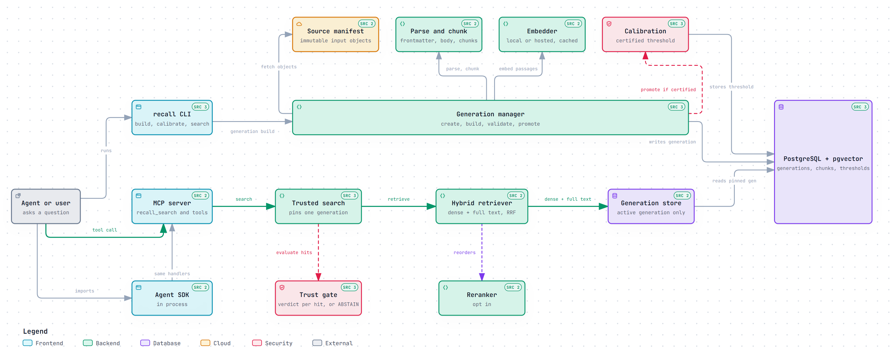

# How RE-call works

The architecture, the optional modules, and what ships. The short version is in the
[README](../README.md).

## What is RE-call

RE-call is agent memory in a local SQLite file or your own PostgreSQL database. It indexes source
documents and keeps validity, lineage, confidence, and provenance attached to every result.

Vector search returns nearby text. RE-call also checks whether that text is current, supported, and
trustworthy enough for the query. A superseded claim is marked `superseded`; a result that does not
clear the calibrated trust gate becomes `ABSTAIN` with a reason. Declared supersession makes the current memory win
over stale but similar memory.

The default path uses local embeddings plus hybrid dense and keyword retrieval. PostgreSQL uses
its full text search; Lite uses SQLite `FTS5`. It needs no memory-layer LLM call. Additional retrieval,
reasoning, and structured-fact modules are optional.

For the agent reading this, [RE-call for agents](FOR_AGENTS.md) explains the experience loop
and how to use persistent memory as a trustworthy past rather than an unverified scratchpad.

## How it works

On PostgreSQL, RE-call builds an immutable, calibrated generation and serves queries against that
pinned generation. Lite binds calibration to its single-file corpus. Every search, including the
reasoning and fact paths, goes through trusted search and the trust gate.

  <a href="https://giulioder.github.io/RE-call/how-it-works.html">
    <picture>
      <source media="(prefers-color-scheme: dark)" srcset="https://raw.githubusercontent.com/GiulioDER/RE-call/master/docs/diagrams/recall-overview-dark.png">
      
    </picture>
  </a>

The diagram is interactive on the [project site](https://giulioder.github.io/RE-call/how-it-works.html):
click any box to see the source lines it describes. A
[step by step view of one `recall_search` call](https://giulioder.github.io/RE-call/diagrams/recall-search.html)
follows a single search through its refusal, abstention and answer paths. Both are generated from
the sources in [docs/diagrams](diagrams/README.md).

Text version of the diagram, with each box linked to its file

Solid arrows are the default path. Dashed arrows are opt in or reasoning only: the reranker, graph
expansion, and the answer provider. Each box links to the file that implements it.

```mermaid
flowchart LR

subgraph group_entry["Entry points"]
  node_cli["recall CLI<br/>commands"]
  node_mcp["MCP server<br/>tool handlers"]
  node_sdk["Agent SDK<br/>in process"]
end

subgraph group_build["Generation build"]
  node_manifest["Source manifest<br/>immutable input"]
  node_generations["Generation manager<br/>build, validate, promote"]
  node_parser["Parse and chunk<br/>documents to chunks"]
  node_embedder["Embedder<br/>local or hosted API"]
  node_graph_build["Semantic graph<br/>entities, relations"]
  node_calibration["Calibration<br/>certified threshold"]
end

subgraph group_serve["Trusted retrieval"]
  node_trusted_search["Trusted search<br/>query orchestrator"]
  node_gen_store["Generation store<br/>pinned generation"]
  node_retriever["Hybrid retriever<br/>dense, full text, RRF"]
  node_reranker["Reranker<br/>opt in"]
  node_trust_gate{{"Trust gate<br/>verdict or ABSTAIN"}}
end

subgraph group_reason["Reasoning"]
  node_reasoner["Reasoning query<br/>evidence bundle, plan"]
  node_graph_expansion["Graph expansion<br/>one hop, before trust"]
  node_answer["Answer provider<br/>opt in LLM"]
end

subgraph group_facts["Provenance and facts"]
  node_provenance["Provenance controller<br/>fact review"]
  node_ledger["Fact ledger<br/>append only"]
end

node_caller(("Agent or user<br/>caller"))
node_postgres[("PostgreSQL + pgvector<br/>generations, chunks, graph")]

node_caller -->|"runs"| node_cli
node_caller -->|"tool calls"| node_mcp
node_caller -->|"imports"| node_sdk
node_sdk -->|"reuses handlers"| node_mcp
node_cli -->|"generation build"| node_generations
node_mcp -->|"ingest uploads"| node_generations
node_generations -->|"reads sources"| node_manifest
node_generations -->|"parses, chunks"| node_parser
node_generations -->|"embeds chunks"| node_embedder
node_generations -->|"builds graph"| node_graph_build
node_generations -->|"requires certified"| node_calibration
node_generations -->|"writes generation"| node_postgres
node_graph_build -->|"writes graph"| node_postgres
node_cli -->|"calibrate, publish"| node_calibration
node_calibration -->|"stores threshold"| node_postgres
node_cli -->|"search"| node_trusted_search
node_mcp -->|"search, evidence"| node_trusted_search
node_trusted_search -->|"pins generation"| node_gen_store
node_gen_store -->|"reads active"| node_postgres
node_trusted_search -->|"retrieves"| node_retriever
node_retriever -->|"embeds query"| node_embedder
node_retriever -->|"dense, full text"| node_gen_store
node_retriever -.->|"reorders"| node_reranker
node_trusted_search -->|"evaluates"| node_trust_gate
node_mcp -->|"reasoning query"| node_reasoner
node_reasoner -->|"retrieves"| node_trusted_search
node_trusted_search -.->|"expands pre trust"| node_graph_expansion
node_graph_expansion -.->|"same generation graph"| node_postgres
node_reasoner -.->|"cited answer"| node_answer
node_mcp -->|"apply fact"| node_provenance
node_provenance -->|"fresh search"| node_trusted_search
node_provenance -->|"appends"| node_ledger
node_ledger -->|"stores"| node_postgres

click node_cli "https://github.com/GiulioDER/RE-call/blob/master/recall/cli.py"
click node_mcp "https://github.com/GiulioDER/RE-call/tree/master/recall_mcp"
click node_sdk "https://github.com/GiulioDER/RE-call/blob/master/recall_agent/memory.py"
click node_manifest "https://github.com/GiulioDER/RE-call/blob/master/recall/manifest.py"
click node_generations "https://github.com/GiulioDER/RE-call/blob/master/recall/generations.py"
click node_parser "https://github.com/GiulioDER/RE-call/blob/master/recall/document.py"
click node_embedder "https://github.com/GiulioDER/RE-call/blob/master/recall/embeddings.py"
click node_graph_build "https://github.com/GiulioDER/RE-call/blob/master/recall/semantic_graph/_build.py"
click node_calibration "https://github.com/GiulioDER/RE-call/blob/master/recall/calibration_v2.py"
click node_trusted_search "https://github.com/GiulioDER/RE-call/blob/master/recall/trust.py"
click node_gen_store "https://github.com/GiulioDER/RE-call/blob/master/recall/generation_store.py"
click node_retriever "https://github.com/GiulioDER/RE-call/blob/master/recall/retriever.py"
click node_reranker "https://github.com/GiulioDER/RE-call/blob/master/recall/rerank.py"
click node_trust_gate "https://github.com/GiulioDER/RE-call/blob/master/recall/trust.py"
click node_reasoner "https://github.com/GiulioDER/RE-call/blob/master/recall/reasoning.py"
click node_graph_expansion "https://github.com/GiulioDER/RE-call/blob/master/recall_mcp/graph_expansion.py"
click node_answer "https://github.com/GiulioDER/RE-call/blob/master/recall/answer_provider.py"
click node_provenance "https://github.com/GiulioDER/RE-call/blob/master/recall/provenance_controller.py"
click node_ledger "https://github.com/GiulioDER/RE-call/blob/master/recall/fact_ledger.py"
click node_postgres "https://github.com/GiulioDER/RE-call/tree/master/recall/migrations"

classDef toneNeutral fill:#f8fafc,stroke:#334155,stroke-width:1.5px,color:#0f172a
classDef toneBlue fill:#dbeafe,stroke:#2563eb,stroke-width:1.5px,color:#172554
classDef toneAmber fill:#fef3c7,stroke:#d97706,stroke-width:1.5px,color:#78350f
classDef toneMint fill:#dcfce7,stroke:#16a34a,stroke-width:1.5px,color:#14532d
classDef toneRose fill:#ffe4e6,stroke:#e11d48,stroke-width:1.5px,color:#881337
classDef toneIndigo fill:#e0e7ff,stroke:#4f46e5,stroke-width:1.5px,color:#312e81
classDef toneTeal fill:#ccfbf1,stroke:#0f766e,stroke-width:1.5px,color:#134e4a
class node_cli,node_mcp,node_sdk,node_caller toneBlue
class node_manifest,node_generations,node_parser,node_embedder,node_graph_build,node_calibration,node_postgres toneAmber
class node_trusted_search,node_gen_store,node_retriever,node_reranker,node_trust_gate toneMint
class node_reasoner,node_graph_expansion,node_answer toneRose
class node_provenance,node_ledger toneIndigo
```

Ordinary `recall search` follows the direct path. Explicit reasoning accepts `graph_expansion`:
`auto` is the default and resolves to bounded one hop expansion for every nonempty query; `off`
keeps direct retrieval only; `one-hop` forces the graph path. The CLI uses
`--graph-expansion auto|off|one-hop`; the MCP tool uses `graph_expansion="auto"|"off"|"one_hop"`.
Graph neighbors are generation bound, direct candidates remain first, and expanded candidates must
clear the same trust boundary before they can support a cited answer.

The opt in choices attach to different points in the system:

| Optional capability | Where it fits | What it adds |
|---|---|---|
| Hosted embedder | Build and query | Remote model calls for embeddings. Query and corpus text may leave the environment. |
| Learned sparse retrieval, SPLADE | Hybrid retrieval | A learned term weighted retrieval leg in addition to dense vectors and Postgres full text. |
| Reranker | After candidate fusion | Reorders the fused candidates with a cross encoder. |
| Evidence Graph version one | Explicit reasoning retrieval | Adds bounded, generation-bound structural neighbors to reasoning retrieval. See `graph_expansion` above for controls; graph candidates pass through trust before a cited answer can use them. |
| Structured fact application | Evidence cards | Lets a reviewed fact pass through the provenance controller into the append only ledger. |

For details, see the [architecture writeup](WRITEUP.md), [provenance controller](PROVENANCE_CONTROLLER.md), and [API reference](API.md).

## Product surface

| Area | What ships |
|---|---|
| Retrieval and memory | Dense vectors plus Postgres full text with hybrid RRF, validity, calibrated confidence, provenance, trust verdicts, immutable generations, incremental indexing, pruning, and source erasure. |
| Structured facts | Citable evidence cards, provenance controller, append only fact ledger, current fact projection, and optional materialization outbox. |
| Quality | Real pgvector integration tests, type checking, linting, dependency audit, and a claim gate that checks published evidence in CI. |

RE-call is not a hosted memory service, dashboard, or automatic truth extractor. It does not rewrite
corpus metadata from an agent's inference. Reasoning is opt in, citation constrained, and review
aware. See [docs/PRODUCTION.md](PRODUCTION.md) for deployment boundaries.
