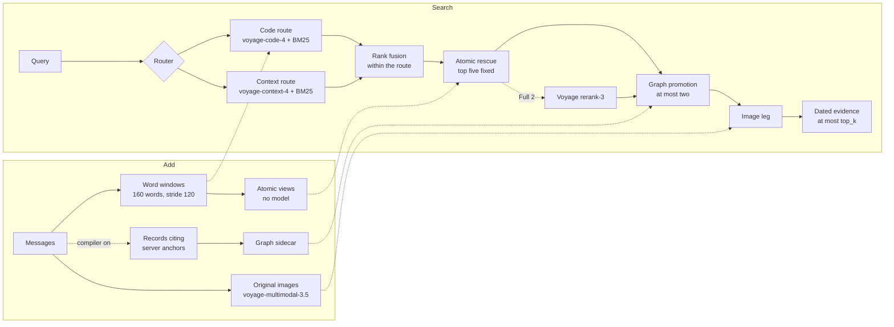

# RE-call Hosted 1.0: method and integration

## Product identity

`RE-call Hosted 1.0` is the fixed hosted distribution of the open source RE-call project: the
public RE-call storage and retrieval layers plus the `recall_aml` package in the same repository.
A deployment's build identity is the Git commit that `/version` reports as `git_commit`. The
`version` field stays `1.0.0` on every build, so it does not identify one. The fixed commit of each
AML run is listed under [Runs of record](#runs-of-record). To cite RE-call, use
[CITATION.cff](../CITATION.cff).

The service is intended to remain reachable and configuration frozen for at least 30 days after
an AML submission. A release candidate must not be submitted until the contract, isolation,
concurrency, latency, persistence, and recovery gates in the committed preregistration pass.

## Method

RE-call Hosted stores what a user said and returns it as dated evidence. It never writes an
answer. Six design choices define the method.



1. Compiled records hold only source text the server verified: the model cites anchor identifiers
   the server created, and the server builds every quote from them (see [Add](#add)).
2. A deterministic router ranks each query in one embedding space, so the ranking never mixes
   scores from different models, and the routing itself uses no model.
3. Every item carries the date a reader needs, including the date a relative phrase refers to.
4. Each Add builds its own atomic views, so a Search between two Adds already uses them, and the
   rescue cannot change the fused top five. In the Full 2 runs the reranker that follows may.
5. The model cannot draw a graph edge: edges come only from verified evidence spans, and
   promotion can only reorder windows that retrieval already found. Each of these rules, and the
   raw ranking served on failure, has a mutation test that fails when the rule is broken
   ([receipts](results/aml-graph-v1/RED_PROOF_RECEIPTS.md)).
6. The image leg searches wherever the user's memory holds images, not only when a question names
   a visual word, and leaves the ranking of a user without images unchanged.

## API

The base URL is supplied privately to AML. All request and response bodies are JSON. Add, Search,
and Delete accept either `Authorization: Bearer <key>` or `X-Api-Key: <key>`. The evaluation uses
a dedicated credential.

### `POST /v1/add`

```json
{
  "request_id": "stable-retry-key",
  "messages": [
    {
      "role": "user",
      "content": "The exact ordered message text",
      "timestamp": 1726133200000
    }
  ],
  "user_id": "exact AML user id",
  "session_id": "exact AML session id"
}
```

The service returns HTTP 200 only after the Add's evidence, and its compiled records when the
compiler is on, have been persisted and made searchable. An identical
`request_id` replay returns the stored original response. Reusing the key with a different body
returns HTTP 409. The maximum request body is 44 MiB so that 30 MiB of decoded inline images can
survive Base64 expansion plus JSON framing. That body limit is the only bound on an Add's size:
there is no per-message length or message-count cap, and an empty or all-blank message list is
stored as a durable, empty Add.

With `RECALL_AML_ADD_RESPONSE_BUDGET_SECONDS` set (off unless set; 0, or 10 to 95 seconds), an Add
still running when the budget runs out is answered HTTP 503 `{"error": "add_in_progress"}` with
`Retry-After: 1` and `X-Recall-Add-Pending: 1`, and the work carries on. A resend with the same
`request_id` and body joins it, or, once it has finished, is answered from its stored response.
HTTP 200 still means the Add is durable, so this 503 is a normal answer to a slow Add and not a
failure. When the service already holds its maximum number of Adds in flight, any further Add
(including a resend) waits with its body unread, and is answered the same way if its budget runs
out first.

With `RECALL_AML_TENANT_LOCK_WAIT_SECONDS` also set (off unless set; 0, or 25 to 1800 seconds, and
only together with the response budget and at least two Add slots), an Add of a user whose earlier Add is still running
queues behind it, first in, first out, and starts the moment it finishes. A delete or a sparse
backfill of that user joins the same queue and waits at most the response budget. An Add that
cannot start within that many seconds, or that finds its user's queue already full, and a delete
or backfill that cannot start within the response budget, change nothing and are answered HTTP
503 `{"error": "tenant_busy"}` with `Retry-After: 60`.

```json
{
  "success": true,
  "request_id": "stable-retry-key",
  "user_id": "exact AML user id",
  "session_id": "exact AML session id"
}
```

### `POST /v1/search`

```json
{
  "query": "original query",
  "user_id": "exact AML user id",
  "top_k": 100,
  "options": ["A. First choice", "B. Second choice"]
}
```

`options` is an optional array of answer choice strings and is omitted for open questions. The
response is `{ "data": [...] }` in product rank order. Every item contains at least `id` and
`content`; optional ranking and provenance fields may also be present. Each item is stored memory
evidence, not a generated answer. The response holds at most `top_k` items, and one that carries
images is also bounded by the decoded response media budget.

### Multimodal content

C9 accepts the AML ordered content shape in both Add messages and the Search query:

```json
[
  {"type": "text", "text": "The deployment panel shows"},
  {"type": "image_url", "image_url": {"url": "data:image/png;base64,..."}},
  {"type": "text", "text": "after the repair"}
]
```

Only inline Base64 JPEG, PNG, and WebP images are accepted. Each decoded image is limited to 10
MiB. One Add request and one Search response are each limited to 30 MiB of decoded images. C9
stores each original image once per tenant under its SHA256, reconstructs the exact ordered parts
at Search, and embeds image-bearing messages with `voyage-multimodal-3.5` in a separate vector
tenant. The main text chunks contain only source text and opaque media references, never Base64.

AML's rule for the Open-source Methods division is that every generative model used during Add or
Search is `gpt-4o-mini`. The Voyage models RE-call uses are embedding models, and each one is named
in the method disclosure of the run that used it.

### `GET /health`

Returns HTTP 200 only after the serving database schema and active generation passed readiness and
startup completed one bounded live request against every model provider stage used by the active
variant. Dependency failures prevent startup or return HTTP 503.

### `GET /version`

Returns the product name and version, `git_commit`, the schema version, the `variant` and its
profiles, `active_components`, the generation model, the prompt digests, the Add response budget
in seconds (`add_response_budget_seconds`, 0 when off), and the tenant queue budget in seconds
(`tenant_lock_wait_seconds`, 0 when off). It contains no credential, database URL, host inventory,
or other infrastructure identifier.

`active_components` is the field that shows which stages run. `retrieval_profile` is a fixed label
present in every build. `reranker` names the reranker model the service loaded (`voyage:rerank-3` at
`b712ec33`), and only `active_components.reranker` says whether it runs.

### `POST /v1/delete`

Accepts `{ "user_id": "exact AML user id" }`. It atomically deletes that user's hosted chunks,
learned sparse sidecars if present, and Add replay receipts. Other user tenants are not touched.

## Model and retrieval configuration

### Runs of record

Every AML Cycle 2 Full that RE-call ran, except the first Multimodal Full, was served by the
variant `C9_routed_specialists_grounded_graph_atomic`, and both second Fulls, which have not run
yet, will be served by it too, selected with
`RECALL_AML_VARIANT=C9_routed_specialists_grounded_graph_atomic`. Each fixed commit is a signed tag
in this repository.

| Track | Run | Fixed commit | Tag | Compiler |
|---|---|---|---|---|
| Textual | Full 1 | `3eb447c4ea1f04f41f941ad8f089c9a02106e763` | `aml-c2-full1-textual` | on |
| Coding | Full 1 | `1f8666df2b04c34efd33153f0751c624fb17b8f6` | `aml-c2-full1-coding` | on |
| Multimodal | Full 2 | `b712ec3304404e6016d02229afb3e3e6df9715f0` | `aml-c2-full2-b712ec33` | off |
| Textual | Full 2 | `b712ec3304404e6016d02229afb3e3e6df9715f0` | `aml-c2-full2-b712ec33` | off |

Both Full 2 runs also set `RECALL_AML_ROUTE_GATES=data`, `RECALL_AML_T1_GATE=content`,
`RECALL_AML_T1_RENDER=v2`, `RECALL_AML_COMPILER=0`, `RECALL_AML_RERANKER=1`,
`RECALL_AML_RERANK_MODEL=rerank-3` and `RECALL_AML_FEEDBACK_GUARD=1`, so `/version` reports
`route_gates` `data`, `multimodal_scope` `dual`, `reranker` `voyage:rerank-3`, and
`active_components.compiler` `false` and `active_components.reranker` `true`. The tag
`aml-c2-full2` on `225e7509` marks an earlier plan for Multimodal Full 2; no run uses it.

Two builds are outside this table. The first Adds of Textual Full 1 were served by the earlier
build `efb79146` (tag `aml-c2-full1-textual-early`) before `3eb447c4` was deployed. Multimodal
Full 1 ran the earlier variant `C8_routed_specialists_grounded_graph` at `5d82b516` (tag
`aml-c2-full1-multimodal`), with the compiler on.

C9's fields are `HostedVariant` in `recall_aml/variants.py`. The three commits define it the same
way except where the sections below name a commit. `b712ec33` is `225e7509` plus two switches, both
off unless set: the reranker switch (`recall_aml/rerank_switch.py`) and the feedback rule
(`recall_aml/feedback_guard.py`).

### License

Every commit named above carries the PolyForm Noncommercial License 1.0.0 in its tree: each is on,
or branched from, the history before the project moved to AGPL-3.0-only.
[`LICENSE_GRANT_AGPL.md`](../LICENSE_GRANT_AGPL.md),
dated 5 October 2026, additionally licenses each of them under AGPL-3.0-only and names each one by
its full commit hash.

### Models

The only generative model is OpenAI `gpt-4o-mini` through OpenRouter, with the fixed model
identifier `openai/gpt-4o-mini`, temperature zero, and a JSON object response. It is called by the
Add compiler, and by one readiness check at service start that compiles a fixed test sentence
(`recall_aml/readiness.py`) and never sees evaluation data. In both Full 2 runs the compiler is off,
so no generative model runs during Add or Search; the readiness check still runs at start. Search
never calls one. Both Full 2
runs also reorder candidates with the Voyage reranker `rerank-3`.

The embedding models are Voyage AI models, one per route:

| Route | Model | Profile | What it searches |
|---|---|---|---|
| code (the default) | `voyage-code-4` | `voyage-code-4-v1` | the tenant's raw windows |
| context | `voyage-context-4` | `voyage-context-4-v1` | a separate tenant holding the same windows and the compiled records |
| image leg | `voyage-multimodal-3.5` | `voyage-multimodal-3.5-v2` | vectors of the image-bearing messages |

The graph sidecar described below embeds its compiled records with `voyage-code-4`.

### Add

The messages of an Add are joined in order and stored as overlapping windows of 160 words with a
stride of 120, in a store isolated per `user_id`. Window text holds message content only, with no
role or timestamp.

The Add also builds atomic views from its own raw windows, with no model: short spans (profile
`aml-add-micro-v1`), each linked to its parent window and stored in an isolated tenant.

In the Full 2 runs, an Add message that records an earlier answer reporting a failure, about a
question this user was already asked, is not stored. Two record shapes are recognised: a message
whose text is a JSON object with a question, the model's answer and its outcome, and a judge verdict
line, the shapes the public AgentMemoryBench protocol (solomoon313/AgentMemoryBench, MIT) writes. A
failed record that also carries the reference answer is kept, and every other message is stored
unchanged.

When the compiler is on, the server cuts the Add's messages into evidence anchors with identifiers
it creates. The model returns at most eight records, each citing one to eight of those identifiers,
and the server builds each record's evidence spans from the cited anchors, so every span is an
exact slice of a source message. A record that cites no supplied anchor is rejected, and a failed
compile stores no records. At `3eb447c4` the model also writes each record's fields; from
`1f8666df` (`anchor_compile_output="select"`) it writes only the kind and the anchor identifiers.
Also from `1f8666df`, the Add's own anchors are bounded to 150,000 encoded characters (a longer Add
is compiled from its first and last anchors), the earlier records sent with it to 145,000, and a
compile refused for exhausted provider credit (HTTP 402) stops the Add with a retryable 503,
storing nothing.

Compiled records go to a graph sidecar tenant. Each carries `references` relations to the raw
windows its evidence spans fall in, and the server resolves both ends of every relation from its
own chunk identifiers. With the compiler off the sidecar stays empty.

### Search

A deterministic router (`route_query` in `recall_aml/specialists.py`) picks one route per query.
A query that carries an image takes the multimodal route, which searches the code route's store
and adds the image leg. Text with a visual word (image, photo, screenshot, chart and similar) also
takes the multimodal route under the default route gates, and the code route under `data`.
Otherwise text with a code signal takes the code route, text with a conversational memory signal
and no code signal takes the context route, and anything else takes the code route.

On the chosen route, exact dense retrieval and canonical BM25 (`k1` 1.5, `b` 0.75) each return 100
candidates, and reciprocal rank fusion with constant 60 merges them. Ties on the code route follow
a fixed window order.

After fusion, atomic rescue can lift the parent window of an atomic view that matches the query,
never into the first five positions. In the Full 2 runs, Voyage `rerank-3` then reorders the whole
candidate pool; a reranker failure serves the fused order. Graph promotion then lets the compiled records nearest the
query move at most two raw windows they reference, which must already be in the ranking, never
into the first eight positions; if it fails, the raw ranking is served. The image leg fuses
`voyage-multimodal-3.5` hits into the ranking: under the default route gates (Textual and Coding
Full 1) on the multimodal route only, and under `data` (both Full 2 runs) on every Search of a
tenant that holds image vectors. A tenant without images gets the text ranking unchanged.

Compiled records that a later record supersedes are left out unless the query asks about the
past. An image-bearing message is returned as its ordered parts with its original images. Every
item carries the time of its source messages in `created_at`, and each text item's content begins
with that date.

From `1f8666df`, a relative time phrase in a returned text item keeps its wording, and the date it
refers to, computed from the item's own date, follows it in brackets. Under the default gate this
skips the code route. Both Full 2 runs use the `content` gate, which covers every route but leaves
code-like items and phrases alone, and the `v2` rendering, which keeps week expressions relative to
an anchor date. Nothing stored, embedded, or ranked changes.

### Variants that served no AML run

With `RECALL_AML_VARIANT` unset the service runs `A4_pack_7000`, the profile this section used to
describe: `voyage-context-4` embeddings, query facets, `voyage:rerank-2.5` over the fused pool, a
pack capped at 12 items and 7,000 characters, and deterministic fallback records when a compile
fails. No AML Cycle 2 run used it. It and the other experimental variants are defined in
`recall_aml/variants.py`.

## Capacity, timeouts, and rate limits

The declared service capacity is 16 concurrent Add requests and 16 concurrent Search requests in
one process. The database pool is sized above the combined running capacity. Add provider and
database work must complete before the caller's 45 second integration timeout. Search callers use
a 10 second transport timeout, while the release gate requires a measured Search p95 below 5
seconds and Add p95 below 30 seconds. HTTP 422 is permanent to the caller, so it is reserved for input
that can never be accepted: invalid JSON, a body over 44 MiB, a missing or blank `request_id`,
`user_id` or `session_id`, and a malformed or oversized image. Everything else the service can store
or answer is accepted: unknown fields are ignored, `content: null` and blank messages are dropped,
an unreadable `timestamp` is dropped, `top_k` is clamped to 0 through 100 (`null` means 100), a
query over 20,000 characters keeps its first 10,000 and last 9,999, and a blank query or
`top_k: 0` returns an empty `data` list. A failure inside the service returns a retryable 503; so
does an Add answered pending (`X-Recall-Add-Pending: 1`, see `POST /v1/add`), which is not a failure,
and an Add answered `tenant_busy` (`Retry-After: 60`, see `POST /v1/add`), which stored nothing.
Authentication failures return HTTP 401.

The C8 and C9 compiler makes at most three provider attempts, twelve seconds each, and sends every
evidence anchor of the Add on the first. If that attempt fails and the encoded anchors exceed
300,000 characters, the remaining attempts send the session's first and last anchors that fit the
budget instead, because an over-long prompt is refused by the model's context window every time.
Within one Add, independent Voyage embedding requests are sent four at a time
(`RECALL_VOYAGE_PARALLEL_REQUESTS`, 1 to 16; 1 restores the sequential behaviour). The vectors are
the ones a sequential run returns; only the wall time of a large Add changes.

## Data handling

Exact text message content is sent through OpenRouter to `gpt-4o-mini` when the compiler is on,
and to the Voyage embedding service. Ordered text and image Data URIs are sent to Voyage's
multimodal embedding endpoint. Images above Voyage's 16 million pixel input limit are
proportionally resized only for that transient embedding request. RE-call stores and returns the
exact original image bytes. Search queries are sent to Voyage only, and in the Full 2 runs the
candidate text that `rerank-3` reorders is sent to Voyage as well. Evidence is stored in the
dedicated PostgreSQL evaluation database. Application logs contain only truncated user, request,
and query digests, counts, latency, fallback flags, and error classes. They never contain messages,
queries, model output, API keys, or database URLs.

The internal tenant is `aml_` plus the SHA256 digest of the exact `user_id`. Multimodal media and
vectors use deterministic `_media` and `_mm` tenant suffixes under the same user boundary.
PostgreSQL row level security applies the tenant inside each pooled transaction. The product stores
exact `session_id` only as evidence metadata so a result can identify its source session. The Delete
endpoint erases the primary tenant and both multimodal sidecars without affecting another user.

## Embedding cache

Hosted deployments may opt into the shared content addressed cache with:

```bash
RECALL_AML_EMBED_CACHE_PATH=/absolute/path/to/aml-hosted-embeddings.sqlite
```

The key binds the complete embedding profile, vector dimension, encoder purpose, and exact input.
Context4 additionally binds the complete ordered document group and chunk ordinal. Multimodal keys
bind canonical structured input and separate document from query vectors. The cache stores only
derived vectors and cannot make one tenant's rows searchable from another tenant. The cache sits
outside the cross process embedding lock: a hit takes no lock, a passage or document miss takes it
for the provider call, and a query miss does not take it.

## Availability and change control

The evaluated endpoint, image, commit, environment digest, and retrieval configuration are frozen
before submission. The service is monitored through `/health`; it restarts on process failure and
uses a Cloudflare Tunnel for public HTTPS. No feature, model, prompt, candidate width, context
budget, or index generation changes during the 30 day availability commitment. Emergency security
or availability repairs require a new fixed commit and are disclosed to AML.
